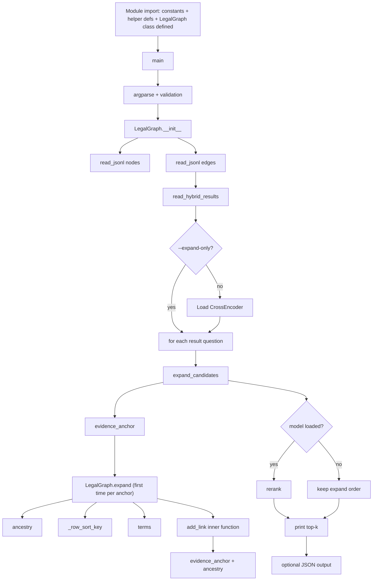

# Graph Expansion + Reranking Script: Line-by-Line Explanation

**Purpose of the script:** take the output of a hybrid (keyword + vector) retrieval run, expand every hit through a *legal graph* (sections, sub-clauses, tables, cross-references), bundle the surrounding context into one "evidence" text per hit, and then rerank those bundles with a cross-encoder model (`Qwen/Qwen3-Reranker-0.6B`).

---

## 1. Execution order (chronological)



> The Mermaid chart above only renders in viewers that support it (GitHub, or VS Code with the "Markdown Preview Mermaid Support" extension). The plain-text version below shows in every viewer.

```text
Module load: constants + terms + read_jsonl + read_hybrid_results
             + class LegalGraph + expand_candidates + rerank + main defined
        |
        v
main()
  |-- 1. argparse + validation of limits
  |
  |-- 2. LegalGraph.__init__()
  |        |-- read_jsonl(graph_nodes.jsonl)   -> self.nodes
  |        |-- read_jsonl(graph_edges.jsonl)   -> parents, children,
  |        |                                      outgoing, incoming, annotations
  |        '-- consistency check (parent / contains agree)
  |
  |-- 3. read_hybrid_results(--input)          -> list of {question, candidates}
  |
  |-- 4. --expand-only ?
  |        |-- no  : import torch, CrossEncoder -> load model
  |        '-- yes : model = None
  |
  '-- 5. for each question result:
           |
           |-- expand_candidates(graph, candidates, ...)
           |     for each hit (in hybrid rank order):
           |       |-- graph.evidence_anchor(hit_id)     cell -> its row
           |       |-- if anchor is new:
           |       |     graph.expand(anchor_id, ...)
           |       |       |-- ancestry(anchor)            section -> anchor chain
           |       |       |-- owned tables (+ _row_sort_key)
           |       |       |-- terms(question)
           |       |       |-- add_link x annotations      (max_annotations)
           |       |       |-- add_link x outgoing         (max_outgoing)
           |       |       |-- add_link x incoming         (max_incoming)
           |       |       |     |-- incoming_score()
           |       |       |     '-- evidence_anchor() + ancestry()
           |       |       |-- build evidence_text under character budget
           |       |       '-- mark links with evidence_included
           |       '-- update retrieved_ids, best_rrf_score, exact_citation_match
           |     returns: list of evidence bundles
           |
           |-- rerank(question, bundles, model)      (skipped if --expand-only)
           |     |-- pairs = (question, evidence_text)
           |     |-- model.predict(pairs)
           |     '-- sort: exact citation > rerank score > RRF score > anchor id
           |
           '-- print top-k for this question
        |
        v
 --output given ?  -> write full JSON, print path
```

Order in which things actually *run*:

1. Python executes the module top to bottom: imports, constants (`PROJECT_ROOT`, `DEFAULT_GRAPH_DIR`, `DEFAULT_MODEL`, `REFERENCE_TYPES`, `RESTRICTION_TERMS`, `WORD`, `STOPWORDS`), then defines `terms`, `read_jsonl`, `read_hybrid_results`, class `LegalGraph`, `expand_candidates`, `rerank`, `main`.
2. `if __name__ == "__main__": main()` starts the real flow.
3. `main()` -> `LegalGraph(...)` (`__init__` calls `read_jsonl` twice) -> `read_hybrid_results` -> optional model load -> per question: `expand_candidates` (-> `evidence_anchor`, `LegalGraph.expand` -> `ancestry`, `terms`, `add_link`, `_row_sort_key`) -> `rerank` -> print -> optional file write.

---

## 2. Top of file: imports and constants

| Line(s) | Explanation |
|---|---|
| `#!/usr/bin/env python3` | Shebang so the file can run directly as a script. |
| Module docstring | One-line description; reused later as the argparse description (`description=__doc__`). |
| `from __future__ import annotations` | Makes type hints lazy strings, allowing `list[dict[str, Any]]` style hints on older Python versions. |
| `argparse, json, re` | CLI parsing, JSON reading/writing, regular expressions. |
| `defaultdict` | Dictionary that auto-creates a missing value (here empty lists). |
| `Path` | Object-oriented file paths. |
| `Any, Iterable` | Typing helpers. |
| `PROJECT_ROOT = Path(__file__).resolve().parent.parent` | Folder one level above the folder containing this script. |
| `DEFAULT_GRAPH_DIR = PROJECT_ROOT / "graph_data"` | Default location of `graph_nodes.jsonl` and `graph_edges.jsonl`. |
| `DEFAULT_MODEL` | Hugging Face id of the reranker. |
| `REFERENCE_TYPES = {"references", "references_schedule"}` | Edge types that mean "A cites B". |
| `RESTRICTION_TERMS = re.compile(...)` | Case-insensitive pattern matching words like *unless, except, notwithstanding, subject to, shall not, does not apply, provided that...*. Used to detect clauses that restrict another clause. |
| `WORD = re.compile(r"[a-z][a-z0-9]{2,}", re.I)` | A "word": starts with a letter, at least 3 characters total. |
| `STOPWORDS` | Common words ignored when comparing text overlap. |

---

## 3. `terms(value)`

**Input / Output**

| | Description |
|---|---|
| **Input** | `value: str`, any text (the user question or a node's text). |
| **Output** | `set[str]`, lowercase keywords of 3+ characters with stopwords removed. |

Example: `terms("Is the fee waived under Section 5?")` returns `{"fee", "waived"}` (`is` is too short, `the`, `under` and `section` are stopwords, `5` does not start with a letter).

```python
def terms(value: str) -> set[str]:
    return {word for word in WORD.findall(value.lower()) if word not in STOPWORDS}
```

| Line | Explanation |
|---|---|
| `def terms(value: str) -> set[str]:` | Takes any text, returns a set of keywords. |
| `value.lower()` | Lowercase so matching is case-insensitive. |
| `WORD.findall(...)` | Finds every word of 3+ characters. |
| `if word not in STOPWORDS` | Drops filler words. |
| Set comprehension | A set removes duplicates. Used later to measure keyword overlap between the question and a node's text. |

---

## 4. `read_jsonl(path)`

**Input / Output**

| | Description |
|---|---|
| **Input** | `path: Path`, a `.jsonl` file (one JSON object per line). |
| **Output** | A generator yielding one `dict` per non-blank line. Raises `ValueError` (with file and line number) if a line is valid JSON but not an object. |

| Line | Explanation |
|---|---|
| `def read_jsonl(path) -> Iterable[dict]` | A **generator**: yields one record at a time instead of loading the whole file. |
| `with path.open(encoding="utf-8") as source:` | Opens the file as UTF-8 and guarantees it is closed afterwards. |
| `for line_number, line in enumerate(source, 1):` | Iterates lines, counting from 1 (for readable error messages). |
| `if line.strip():` | Skips blank lines. |
| `record = json.loads(line)` | Each line is one JSON document. |
| `if not isinstance(record, dict): raise ValueError(...)` | Each line must be a JSON object; the error includes file and line number. |
| `yield record` | Hands the record to the caller and pauses until the next one is requested. |

---

## 5. `read_hybrid_results(path)`

**Input / Output**

| | Description |
|---|---|
| **Input** | `path: Path`, saved hybrid retrieval output: one JSON object, or several objects written back to back. |
| **Output** | `list[dict]`, each with at least `question` and a `candidates` list (each candidate has `id`, and optionally `rrf_score`, `citation`, `exact_citation_match`). Raises `ValueError` if an object lacks `candidates` or the file is empty. |

Reads the saved hybrid retrieval output. The file may contain **one** JSON object or **several objects written back to back** (from a `--test` run), which `json.load` alone cannot handle.

| Line | Explanation |
|---|---|
| `raw = path.read_text(encoding="utf-8")` | Whole file as a string. |
| `decoder = json.JSONDecoder()` | Low-level decoder able to parse one object at a time. |
| `results = []`, `offset = 0` | Collected objects and the current read position. |
| `while offset < len(raw):` | Loop until the text is consumed. |
| `while offset < len(raw) and raw[offset].isspace(): offset += 1` | Skip whitespace between objects. |
| `if offset == len(raw): break` | Only trailing whitespace remained, so stop. |
| `result, offset = decoder.raw_decode(raw, offset)` | Parse one object starting at `offset`; returns the object and the new offset right after it. |
| `if not isinstance(result, dict) or not isinstance(result.get("candidates"), list): raise` | Each object must be a dict with a `candidates` list, otherwise it is not a hybrid result. |
| `results.append(result)` | Keep it. |
| `if not results: raise ValueError(... "no hybrid results found")` | Empty file is an error. |
| `return results` | List of result dicts, each with `question` and `candidates`. |

---

## 6. `class LegalGraph`

An in-memory graph of legal text. **Nodes** are units like sections, schedules, paragraphs, tables, rows, cells. **Edges** describe structure (`parent`/`contains`) and meaning (`references`, `annotates`).

### 6.1 `__init__(self, nodes_path, edges_path)`

**Input / Output**

| | Description |
|---|---|
| **Input** | `nodes_path: Path` to `graph_nodes.jsonl`; `edges_path: Path` to `graph_edges.jsonl`. |
| **Output** | No return value. Builds in-memory lookups on `self`: `nodes` (id to node), `parents` (child to parent), `children` (parent to child list), `outgoing` / `incoming` (reference edges), `annotations` (target to annotation edges). Raises `ValueError` on duplicate or invalid node ids, edges with missing endpoints, multiple parents, or parent/contains mismatch. |

| Line(s) | Explanation |
|---|---|
| `self.nodes = {}` | Maps node id to node dict. |
| `for node in read_jsonl(nodes_path):` | Stream every node. |
| `node_id = node.get("id")` | Each node needs an id. |
| `if not isinstance(node_id, str) or not node_id or node_id in self.nodes: raise` | Id must be a non-empty string and unique. |
| `self.nodes[node_id] = node` | Register it. |
| `self.parents = {}` | child id to parent id. |
| `self.children = defaultdict(list)` | parent id to ordered list of child ids. |
| `self.outgoing = defaultdict(list)` | source id to reference edges it makes. |
| `self.incoming = defaultdict(list)` | target id to reference edges pointing at it. |
| `self.annotations = defaultdict(list)` | target id to annotation edges attached to it. |
| `for edge in read_jsonl(edges_path):` | Stream every edge. |
| `if edge.get("resolution_status") != "resolved": continue` | Ignore edges whose target could not be resolved. |
| `source, target = edge.get("from_id"), edge.get("to_id")` | Edge endpoints. |
| `if source not in self.nodes or target not in self.nodes: raise` | A resolved edge must point at real nodes. |
| `if edge_type == "parent":` | Child-to-parent edge. |
| `if source in self.parents and self.parents[source] != target: raise` | A node may not have two different parents (tree rule). |
| `self.parents[source] = target` | Record the parent. |
| `elif edge_type == "contains" and target not in self.children[source]:` | Parent-to-child edge, de-duplicated. |
| `self.children[source].append(target)` | Preserve child order. |
| `elif edge_type in REFERENCE_TYPES:` | Cross-reference edge. |
| `self.outgoing[source].append(edge)` / `self.incoming[target].append(edge)` | Store in both directions so we can look up "what I cite" and "who cites me". |
| `elif edge_type == "annotates": self.annotations[target].append(edge)` | Notes attached to a node. |
| Final `for child, parent in self.parents.items():` | Consistency check after loading. |
| `if self.nodes[child].get("parent_id") != parent or child not in self.children[parent]: raise` | The `parent` edge, the node's own `parent_id` field and the `contains` edge must agree. |

### 6.2 `ancestry(self, node_id, max_depth=16)`

**Input / Output**

| | Description |
|---|---|
| **Input** | `node_id: str`; `max_depth: int = 16`. |
| **Output** | `list[dict]` of node dicts, ordered from the enclosing section or schedule (first) down to `node_id` (last). Raises `ValueError` for an unknown id, a structural cycle, or a chain deeper than `max_depth`. |

Example: For a sub-clause `S5.2(a)` it returns `[Section 5, 5.2, 5.2(a)]`.

Returns the chain from the enclosing **section/schedule** down to the node (top first).

| Line(s) | Explanation |
|---|---|
| `if node_id not in self.nodes: raise` | Unknown id. |
| `chain = []`, `seen = set()`, `current = node_id` | Collected nodes, cycle detector, cursor. |
| `while current and len(chain) < max_depth:` | Walk upward, bounded. |
| `if current in seen: raise ValueError("Structural cycle")` | Parent loop means corrupt data. |
| `seen.add(current)`; `chain.append(self.nodes[current])` | Record the visit and the node. |
| `if node_type in {"section", "schedule"}: break` | Stop at the top-level legal unit. |
| `current = self.parents.get(current)` | Move up one level (or `None` at a root). |
| After loop: `if current and chain[-1].get("node_type") not in {...}:` | Loop ended without reaching a section/schedule. |
| `if self.parents.get(current): raise ... exceeds max_depth` | If more parents remain, the depth limit cut it off, which is an error rather than silent truncation. |
| `return list(reversed(chain))` | Flip so the order is section first, target node last. |

### 6.3 `evidence_anchor(self, node_id)`

**Input / Output**

| | Description |
|---|---|
| **Input** | `node_id: str`, the id of a retrieved or linked node. |
| **Output** | `str`, the anchor id. A `table_cell_item` returns its enclosing `table_row` id; every other node returns its own id. Raises `ValueError` for an unknown id. |

A hit on a **single table cell** is scored together with its **whole row**.

| Line(s) | Explanation |
|---|---|
| `if node_id not in self.nodes: raise` | Validate. |
| `if node_type != "table_cell_item": return node_id` | Non-cell nodes are their own anchor. |
| `current = node_id` | Start at the cell. |
| `while current in self.parents:` | Climb. |
| `current = self.parents[current]` | One level up. |
| `if node_type == "table_row": return current` | First row ancestor is the anchor. |
| `return node_id` | Fallback if no row was found. |

### 6.4 `expand(self, anchor_id, ...)`

**Input / Output**

| | Description |
|---|---|
| **Input** | `anchor_id: str`; `max_table_rows=8`; `question=""`; `max_outgoing=3`; `max_incoming=2`; `max_annotations=2`; `max_evidence_chars=8000`; `max_node_chars=2500`. |
| **Output** | One evidence bundle `dict` with keys: `anchor_id`, `citation`, `evidence_text` (passages joined by newlines), `source_ids` (nodes that made it into the text), `omitted_table_rows` (table id to row count), `links` (each with `relation`, `edge_type`, `from_id`, `to_id`, `reference_text`, `source_properties`, `evidence_included`), `omitted_links` (counts cut by the caps), `expansion_gaps` (known coverage problems), `truncated_source_ids`. |

The core function. Builds one **evidence bundle** for an anchor.

**Parameters:** `max_table_rows` (include a table only if it has this many rows or fewer), `question` (for relevance scoring), `max_outgoing`, `max_incoming`, `max_annotations` (link caps), `max_evidence_chars` (total text budget), `max_node_chars` (per-node cap).

**Part A: structural context**

| Line(s) | Explanation |
|---|---|
| `chain = self.ancestry(anchor_id)` | Section down to the anchor. |
| `evidence_nodes = [(chain[-1], "structural"), *((n, "structural") for n in chain[:-1])]` | List of `(node, why_included)`. The anchor goes **first** so a tight character budget still keeps the retrieved unit itself; then ancestors in top-down order. |
| `anchor = self.nodes[anchor_id]` | The anchor node. |
| `omitted_table_rows = {}` | Records tables skipped for being too large. |

**Part B: owned tables**

| Line(s) | Explanation |
|---|---|
| `if anchor type not in {"table_row", "table_cell_item"}:` | A retrieved row already holds its values; sibling rows are not added. |
| `for child_id in self.children.get(anchor_id, []):` | Look at the anchor's children. |
| `if table.get("node_type") != "table": continue` | Only tables matter. |
| `evidence_nodes.append((table, "table_context"))` | Add the table (its columns are rendered later). |
| `rows = [... table_row children ...]` | Collect its rows. |
| `if len(rows) <= max_table_rows:` | Small table: include every row, sorted by `_row_sort_key`. |
| `else: omitted_table_rows[child_id] = len(rows)` | Large table: skip rows and record how many. |

**Part C: preparing link search**

| Line(s) | Explanation |
|---|---|
| `source_ids = [ids in chain with non-empty text]` | Nodes whose own text can contain references or annotations. |
| `lookup_ids = [all ids in chain]` | Nodes checked for who references them. |
| `query_terms = terms(question)` | Keywords for ranking links. |
| `links`, `omitted_links`, `expansion_gaps` | Output lists/counters. `expansion_gaps` records known coverage problems. |

**Inner function `add_link(edge, relation)`**

**Input / Output**

| | Description |
|---|---|
| **Input** | `edge: dict` (a graph edge); `relation: str`, one of `"annotation"`, `"outgoing"`, `"incoming_candidate"`. |
| **Output** | No return value. Side effects: appends the linked node and its ancestry to `evidence_nodes`, appends a metadata record to `links`, and may add a message to `expansion_gaps`. Returns early (does nothing) if the target is a placeholder. |

| Line(s) | Explanation |
|---|---|
| `target_id = edge["to_id"] if relation == "outgoing" else edge["from_id"]` | For outgoing links we want the cited node; for annotations/incoming we want the source of the edge. |
| `if target.get("is_placeholder"): return` | Ignore placeholder nodes (no real text). |
| `if outgoing and target is a schedule: expansion_gaps.append(...)` | A citation of a whole Schedule with no paragraph locator is flagged as imprecise. |
| `linked_anchor = self.evidence_anchor(target_id)` | A cited cell is replaced by its row. |
| `for node in self.ancestry(linked_anchor): evidence_nodes.append((node, relation))` | Add the cited unit with its parent chain for context. |
| `links.append({...})` | Record link metadata (relation, edge type, ids, reference text, source properties) for the output. |

**Part D: annotations**

| Line(s) | Explanation |
|---|---|
| `for node_id in source_ids:` | Every node with text. |
| `notes = sorted(self.annotations.get(node_id, []), key=from_id)` | Deterministic order. |
| `for edge in notes[:max_annotations]: add_link(edge, "annotation")` | Keep the first N. |
| `omitted_links["annotation"] += max(0, len(notes) - max_annotations)` | Count what was cut. |

**Part E: outgoing references**

| Line(s) | Explanation |
|---|---|
| `outgoing = [edges from all source_ids]` | All citations made by the chain. |
| `outgoing.sort(key=(...))` | Priority: (1) edges from the anchor itself first, (2) more keyword overlap between the question and the cited text first, (3) target id as a tie-breaker. The leading `-` makes bigger values sort first. |
| `for edge in outgoing[:max_outgoing]: add_link(edge, "outgoing")` | Take the top N. |
| `omitted_links["outgoing"] = ...` | Count the rest. |

**Part F: incoming references (restrictions on this text)**

| Line(s) | Explanation |
|---|---|
| `incoming = [edges pointing at any chain node]` | Who cites us. |
| `incoming = [e for e in incoming if e["from_id"] not in lookup_ids]` | Drop self-references within the chain. |
| `incoming_score(edge)` | **Input:** `edge: dict`. **Output:** `tuple[int, int, int]` = (1 if the citing node is in the same section as the anchor else 0, 1 if its text matches `RESTRICTION_TERMS` else 0, number of keywords it shares with the question). |
| Loop building `eligible_incoming` | Rejects **broad ranges** (a range covering more than 8 members), and **broad Schedule roots** (target is a schedule other than the anchor). Keeps an edge only if it is in the same section, or it is restrictive *and* shares 2+ keywords with the question. |
| `omitted_links["incoming_unselected"]` | How many were filtered out. |
| `incoming.sort(...)` | Best score first, id as tie-breaker. |
| `add_link(edge, "incoming_candidate")` for the top N | They are labelled *candidates* because the system cannot be sure they truly limit the anchor. |
| `omitted_links["incoming_candidate"]` | Count the overflow. |

**Part G: assembling the text under a budget**

| Line(s) | Explanation |
|---|---|
| `parts`, `used_chars`, `included_ids`, `seen_ids`, `truncated_ids` | Accumulators. |
| `for node, relation in evidence_nodes:` | Process in priority order. |
| `if node["id"] in seen_ids: continue` | De-duplicate nodes reached by several paths. |
| `citation`, `title`, `body` | Pull display fields (citation falls back to id). |
| `if node_type == "table":` | Replace body with `Table columns: a; b; c` from `source_properties.columns`. |
| `if node_type in {"section","schedule"} and title:` | Show `citation — title`. |
| `was_truncated = len(body) > max_node_chars` | Per-node cap. |
| `body = body[:max_node_chars].rsplit(" ", 1)[0] + " [truncated]"` | Cut at the last whole word and mark it. |
| `if body: passage = f"{citation}: {body}"` | Normal passage. |
| `elif section/schedule: passage = citation` | Heading-only nodes still give context. |
| `else: continue` | Empty nodes are skipped. |
| `if used_chars + len(passage) + bool(parts) > max_evidence_chars:` | Would exceed the budget (the `+ bool(parts)` counts the newline separator). |
| `expansion_gaps.append("Evidence character budget reached..."); break` | Record and stop. |
| `parts.append(passage)`; `used_chars += ...`; `included_ids.append(...)` | Accept the passage. |
| `if was_truncated: truncated_ids.append(...)` | Remember which nodes were cut. |

**Part H: mark which links made it in**

| Line(s) | Explanation |
|---|---|
| `for link in links:` | Each recorded link. |
| `evidence_id = to_id if outgoing else from_id` | The node that carried the evidence. |
| `link["evidence_included"] = self.evidence_anchor(evidence_id) in included_ids` | `True` only if that text really survived the budget. |

**Return value:** a dict with `anchor_id`, `citation`, `evidence_text` (joined with newlines), `source_ids`, `omitted_table_rows`, `links`, `omitted_links`, `expansion_gaps`, `truncated_source_ids`.

### 6.5 `_row_sort_key(row)` (static method)

**Input / Output**

| | Description |
|---|---|
| **Input** | `row: dict`, a `table_row` node. |
| **Output** | `tuple[int, str]`: (row number, or 1,000,000,000 if missing, row id). Used as a sort key so rows come out in table order. |

| Line | Explanation |
|---|---|
| `number = str((row.get("source_properties") or {}).get("row_number") or "")` | Reads the row number safely as a string. |
| `return (int(number) if number.isdigit() else 10**9, row["id"])` | Numeric rows sort by number; rows without a number go last; id breaks ties. |

---

## 7. `expand_candidates(graph, candidates, ...)`

**Input / Output**

| | Description |
|---|---|
| **Input** | `graph: LegalGraph`; `candidates: list[dict]` (hybrid hits for one question, in rank order); `max_table_rows=8`; `question=""`; `max_evidence_chars=8000`; `max_outgoing=3`; `max_incoming=2`; `max_annotations=2`. |
| **Output** | `list[dict]`, one bundle per unique anchor, in order of first appearance. Each bundle is the `expand()` result plus `retrieved_ids` (all hits that mapped to it), `first_hybrid_rank`, `best_rrf_score`, and `exact_citation_match`. |

Turns the retrieval hits for **one question** into unique evidence bundles.

| Line(s) | Explanation |
|---|---|
| `bundles = {}` | anchor id to bundle. |
| `for position, candidate in enumerate(candidates, 1):` | Hits in hybrid-rank order, rank starting at 1. |
| `hit_id = candidate["id"]` | The retrieved node. |
| `anchor_id = graph.evidence_anchor(hit_id)` | Cells map to their row. |
| `if anchor_id not in bundles:` | First time seeing this anchor. |
| `graph.expand(...)` spread into a dict plus `retrieved_ids: []`, `first_hybrid_rank: position`, `best_rrf_score`, `exact_citation_match: False` | Create the bundle with retrieval metadata. Expansion is the expensive step, so it runs once per anchor even if several hits share it. |
| `bundle = bundles[anchor_id]` | Fetch it. |
| `bundle["retrieved_ids"].append(hit_id)` | Record every hit that led here. |
| `bundle["best_rrf_score"] = max(...)` | Keep the best hybrid (RRF) score among the hits. |
| `citation_only_match = (question normalised == candidate citation normalised)` | Strips quotes/punctuation and compares case-insensitively; true when the user just typed a citation like `Section 12`. |
| `bundle["exact_citation_match"] \|= bool(candidate.get("exact_citation_match")) or citation_only_match` | Mark the bundle if either the retriever or this check found an exact citation match. |
| `return list(bundles.values())` | Bundles in order of first appearance. |

---

## 8. `rerank(question, bundles, model, batch_size=1)`

**Input / Output**

| | Description |
|---|---|
| **Input** | `question: str`; `bundles: list[dict]` from `expand_candidates`; `model` (a loaded `CrossEncoder`); `batch_size: int = 1`. |
| **Output** | `list[dict]`, the same bundles with a new `rerank_score` (float), sorted by exact citation match, then rerank score, then best RRF score, then anchor id. Returns `[]` for empty input. Raises `ValueError` if the model returns the wrong number of scores. |

| Line(s) | Explanation |
|---|---|
| `if not bundles: return []` | Nothing to do. |
| `pairs = [(question, bundle["evidence_text"]) ...]` | Cross-encoder input: (query, document). |
| `scores = model.predict(pairs, batch_size=..., show_progress_bar=False)` | One relevance score per pair. |
| `if len(scores) != len(bundles): raise` | Safety check. |
| `scored = [{**bundle, "rerank_score": float(score)} ...]` | Copy each bundle and attach its score. |
| `sorted(scored, key=(...))` | Final order: (1) exact citation matches first, (2) higher rerank score, (3) higher RRF score, (4) anchor id for determinism. The negative signs make larger values come first. |

---

## 9. `main()`

**Input / Output**

| | Description |
|---|---|
| **Input** | No Python arguments. Reads the command line: `--input` (required), `--graph-dir`, `--output`, `--expand-only`, `--model`, `--batch-size`, `--max-table-rows`, `--max-evidence-chars`, `--max-outgoing`, `--max-incoming`, `--max-annotations`, `--top-k`. |
| **Output** | Returns nothing. Prints, for each question, a header and the top-k ranked bundles (`position. citation [anchor_id] rerank=score`). If `--output` is given, writes a JSON list of `{question, bundles}` to that file and prints its path. |

| Line(s) | Explanation |
|---|---|
| `parser = argparse.ArgumentParser(description=__doc__)` | CLI definition. |
| `--input` (required) | Saved hybrid retrieval JSON. |
| `--graph-dir` | Folder with graph files (default `graph_data`). |
| `--output` | Optional file for the full JSON result. |
| `--expand-only` | Skip the model; just show the expanded bundles. |
| `--model`, `--batch-size` | Reranker choice and batch size. |
| `--max-table-rows`, `--max-evidence-chars` | Table and text budgets. |
| `--max-outgoing`, `--max-incoming`, `--max-annotations` | Link caps. |
| `--top-k` | How many results to print. |
| `args = parser.parse_args()` | Parse. |
| `if min(batch_size, max_table_rows, max_evidence_chars, top_k) < 1: parser.error(...)` | These must be positive. |
| `if min(max_outgoing, max_incoming, max_annotations) < 0: parser.error(...)` | Link limits may be zero but not negative. |
| `graph = LegalGraph(graph_nodes.jsonl, graph_edges.jsonl)` | Load the graph. |
| `inputs = read_hybrid_results(args.input)` | Load the questions and hits. |
| `model = None` | Default for expand-only. |
| `if not args.expand_only:` | Import heavy libraries only when needed. |
| `import torch`; `from sentence_transformers import CrossEncoder` | Lazy imports. |
| `device = "mps" if torch.backends.mps.is_available() else "cpu"` | Use Apple GPU if present. |
| `dtype = float16 if mps else float32` | Half precision on MPS for speed and memory. |
| `model = CrossEncoder(args.model, device=device, model_kwargs={"torch_dtype": dtype})` | Load the reranker. |
| `outputs = []` | Collected results. |
| `for result in inputs:` | One iteration per question. |
| `bundles = expand_candidates(...)` | Expand with the CLI limits. |
| `ranked = rerank(...) if model else bundles` | Rerank, or keep expansion order. |
| `outputs.append({"question": ..., "bundles": ranked})` | Save for file output. |
| `print(...)` header, then loop over `ranked[:args.top_k]` | Console report: `position. citation [anchor_id] rerank=score`. |
| `if args.output:` | Optional file output. |
| `args.output.parent.mkdir(parents=True, exist_ok=True)` | Create folders as needed. |
| `args.output.write_text(json.dumps(outputs, ensure_ascii=False, indent=2) + "\n", encoding="utf-8")` | Write readable UTF-8 JSON (non-ASCII preserved). |
| `print(f"Full evidence: {args.output}")` | Tell the user where. |
| `if __name__ == "__main__": main()` | Run only when executed directly, not when imported. |

---

## 10. Typical usage

```bash
# Expansion only (no model, fast, good for debugging)
python rerank_graph.py --input hybrid.json --expand-only

# Full rerank, save everything
python rerank_graph.py --input hybrid.json --output out/rerank.json --top-k 5
```

## 11. Key design ideas to remember

- **Anchor first, context second:** the retrieved unit is always first in the evidence text, so budget cuts remove context, not the hit.
- **Table cells become rows** so the reranker sees a full row, not an isolated value.
- **Outgoing references** ("this section cites X") are ranked by question overlap; **incoming references** are kept only if they look like restrictions (*unless, except...*) so exceptions are not missed.
- **Everything is bounded** (rows, links, characters), and every omission is recorded (`omitted_*`, `expansion_gaps`, `truncated_source_ids`) so results are auditable.
- **Strict validation** (duplicate ids, multiple parents, cycles, mismatched edges) means bad graph data fails loudly instead of producing wrong evidence.